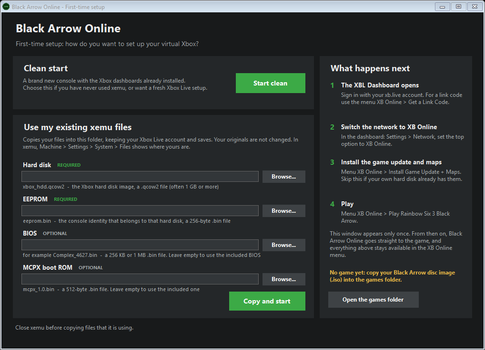
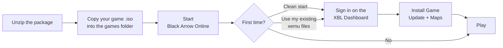
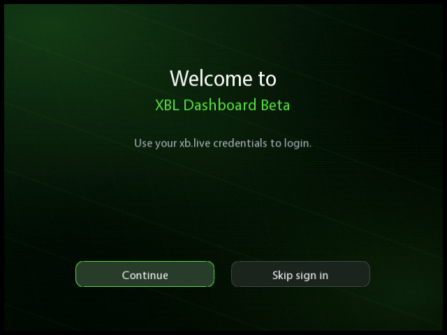
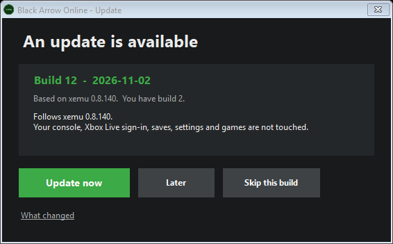

# Black Arrow Online

Play **Rainbow Six 3: Black Arrow** online again, on your PC, through
[XB Online](https://xb.live).

Black Arrow Online is a ready-to-use build of [xemu](https://xemu.app), the
original Xbox emulator, with a launcher and an **XB Online** menu that take
care of the setup: the console, the Xbox Live account, the game update and
the map packs.

  

## What you need

| | |
|---|---|
| **The full Black Arrow Online package** | Shared in the community, complete and ready to run. The [releases](../../releases) here are updates for it, not the package itself. |
| **Your own Black Arrow disc image** | An `.iso` of your game. It is not included. |
| **An xb.live account** | Free, at [xb.live](https://xb.live). |
| **A PC** | Windows 10 or 11 (64-bit), a Mac, or a 64-bit Linux PC or Steam Deck with a Linux from 2022 or later (new, see [On Linux](#on-linux)). A controller is recommended. |

## Getting started

1. **Unzip** the package anywhere, for example your Desktop.
2. **Copy your game** disc image into the `games` folder.
3. **Start `Black Arrow Online`.** The first time, choose:
   - **Clean start** for a brand new console, or
   - **Use my existing xemu files** to copy in the hard disk and EEPROM of an
     xemu you already use. Your originals are not changed.
4. **Sign in.** The XBL Dashboard opens. Sign in with your xb.live account,
   then in *Settings > Network* set the top option to **XB Online**.
5. **Install the update and maps:** menu *XB Online > Install Game Update +
   Maps*. Skip this if your own hard disk already has them.
6. **Play:** menu *XB Online > Play Rainbow Six 3 Black Arrow*.

After that, starting `Black Arrow Online` goes straight to the game.

  

## On Linux

New since build 25. Get the full Linux package from where Black Arrow Online
is shared, unpack it, open a terminal in the `BlackArrowOnline` folder and
run `bash setup.sh`. It installs into your home folder (no password), adds
**Black Arrow Online** to your applications menu and opens the `games`
folder for your disc image. Updates come in by themselves, like on Windows
and Mac. The `README.txt` in the package has the Steam Deck steps. Linux is
new, so please report what works and what does not.

## The XB Online menu

Everything you need later is in the **XB Online** menu at the top of the
window. On a controller, the Guide/Home button opens the same options.

| Menu item | What it does |
|---|---|
| **Play &lt;game&gt;** | Starts a game from the `games` folder |
| **Add or Load Another Game** | Picks a disc image stored somewhere else |
| **XBL Dashboard (Account Setup)** | Sign in, link or fix your Xbox Live account |
| **Original Xbox Dashboard** | The standard Xbox dashboard: saves and settings |
| **Install Game Update + Maps** | Black Arrow title update and map packs |
| **Get a Link Code** | Opens xb.live/link in your browser |

## Updates

When a newer build is released, the launcher offers it the next time you
start. An update replaces the launcher and the emulator only. Your console,
Xbox Live sign-in, saves, settings and games are not touched.

  

- **Later** asks again next time. **Skip this build** waits for the one after.
- The previous emulator is kept as `system\xemu.previous.exe`.
- To turn the check off, create an empty file `system\no-update-check.txt`.
- To update by hand, close the emulator and unzip
  `BlackArrowOnline-update.zip` from the [latest release](../../releases/latest)
  over your Black Arrow Online folder.

New builds are made automatically when this repository changes and when xemu
publishes a new release.

## Hosting a game

- **Players on your own network** (another PC or a real Xbox) can join a game
  you host as it is. Allow xemu through Windows Firewall when Windows asks.
- **Players over the internet** can join only if your router forwards UDP
  port 3074 to your PC.
- One copy of Black Arrow Online per PC can host.

## Trouble

| Problem | Try |
|---|---|
| The game looks wrong | *Machine > Settings > Display*, turn off "Skip render target copy-back (speed hack)" |
| The game is slow | *View > Int. Resolution Scale*, choose 1x |
| Start over with a new console | Run `system\Start over.bat`. It removes the console in that folder only |

## What is changed from xemu

- An **XB Online** menu and a first start that opens account setup.
- A network setting that points the console's Xbox Live lookups at XB Online.
- With NAT networking the console uses the computer's own network address, so
  players on the same network can join a game hosted in the emulator.
- Settings, BIOS and disk paths relative to the program folder, so the whole
  setup lives in one folder.
- A fix for menu textures in Black Arrow and an optional rendering speed-up.
- Lower CPU use while idle.

The source changes are the commits on top of the xemu history. The launcher,
the package files and the build scripts are in
[`black-arrow-online/`](black-arrow-online/).

## What is not here

The Xbox BIOS and MCPX boot ROM, the Xbox dashboard, the XBL Dashboard, hard
disk images and game content are not in this repository or its releases.

They come with the full package, from where Black Arrow Online is shared.
The downloads on the [releases](../../releases) page are updates for a
package you already have: on their own they cannot set up a new console, and
the setup window shows **Add content pack** instead of **Start clean**. If
you see that, get the full package and start from it.

## Credits and licence

Black Arrow Online is built on [xemu](https://github.com/xemu-project/xemu)
by Matt Borgerson and contributors, which is based on QEMU. Online play is
provided by [XB Online](https://xb.live). This project is not affiliated with
either, nor with Microsoft or Ubisoft.

xemu is licensed under the GNU General Public License, version 2 or later;
see [`LICENSE`](LICENSE) and [`COPYING`](COPYING). Each release includes the
complete source it was built from.
